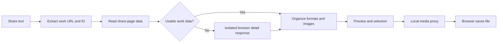

# DouyinLens · Douyin Video Parsing and Downloading

[简体中文](README.md) | [English](README.en.md)

Turn a Douyin share message into a video preview and downloadable quality options, with support for image galleries and covers. Use it locally to save material you are entitled to use and to explore how share-page data, browser responses, and media streams fit together.

Python serves the local interface and media proxy. Playwright loads the work page when share-page data is incomplete. No model key, database, or paid parsing API is required. The application listens on the local machine by default.

[Start](#run-locally) · [Download](#from-a-share-message-to-a-local-file) · [Implementation](#why-there-are-two-parsing-paths) · [Troubleshooting](#troubleshooting)

## Run locally

Prepare Python 3.10+ and a network connection that can reach Douyin and its CDN. In Windows PowerShell:

```powershell
git clone https://github.com/kayaduster607-jpg/douyin-lens.git
cd douyin-lens
python -m venv .venv
.\.venv\Scripts\python.exe -m pip install -r requirements.txt
.\.venv\Scripts\python.exe app.py
```

Open [http://127.0.0.1:8080](http://127.0.0.1:8080). The program tries system Edge, Chrome, and Playwright Chromium in that order. If no usable browser is installed, install Chromium in the same virtual environment:

```powershell
.\.venv\Scripts\python.exe -m playwright install chromium
```

## From a share message to a local file

1. Copy a share message for a work you can open normally in Douyin and paste the entire message into the input. A work URL alone also works: the program extracts the URL, follows short links, and identifies the work ID.
2. Click “解析视频” (parse video) and wait for the title, cover, and player. A new work can take tens of seconds if browser fallback is needed.
3. For videos, select one of the **actually listed** quality options and download. For galleries, download individual images from the list. Use the separate cover button for the cover image.
4. Check progress in the browser's download manager and open the completed file. A visible cover or preview does not mean the full video has been saved.

| Input | Page output | File output |
| --- | --- | --- |
| Video share text / URL | Title, cover, video preview, available formats | MP4 in the browser's download directory |
| Gallery share text / URL | Image list and previews | Selected image files |
| Cover action on a parsed work | Cover image | Separate image file |

Videos are not saved into the repository by default. Resolution and bitrate come from the upstream detail response; 1080p or 4K is not guaranteed for every work. The program does not perform super-resolution.

### Interface example


This historical runtime screenshot shows work information, a video preview, and downloadable formats. Third-party material belongs to its original creator. See the [home screenshot](docs/assets/runtime-home.jpg) and [runtime conditions and verification record](docs/verification.md). The interface retains the `DouYinDownloader` name; the repository is named DouyinLens.

## Why there are two parsing paths



When the share page embeds work data, a direct request is sufficient. When fields are missing, adding a User-Agent does not execute JavaScript, so an isolated browser listens for the target work's detail response. The same response supplies video URLs, `bit_rate`, covers, and galleries. Formats are deduplicated by resolution, retaining the higher bitrate.

During download, Python supplies media request headers, proxies the upstream stream, and forwards Range, Content-Range, and HTTP 206. **Finding a playback URL and transferring video bytes are separate steps**; CDN downloading can still fail after parsing succeeds.

The browser uses an isolated session and does not read your existing personal browser profile. Successful browser results are cached in memory for 180 seconds, with at most 32 entries. Browser cache misses run serially; the HTTP server itself is multithreaded. Only browser results are cached: short-link and share-page requests may still run again, so the cache does not make the whole pipeline instantaneous.

“Watermark-free” means trying to obtain existing platform playback resources, including changing legacy `playwm` paths to `play`. It does not erase logos, subtitles, or watermarks already embedded by creators.

## Troubleshooting

| Symptom | Cause and next check |
| --- | --- |
| Share page returns HTTP 200 but no video | Check whether work fields exist; the program attempts browser detail fallback |
| Your browser can play it but the program fails | The isolated browser lacks your login state; permissions, verification requirements, and network conditions may differ |
| The page keeps waiting | Browser startup and detail responses take time; the browser stage has a 45-second budget, with other network steps in the overall request |
| Playwright / browser missing | Check that installation and startup use the same virtual environment; install Chromium if needed |
| Preview works but download fails | Inspect media requests and CDN status rather than relying on parsing alone |

Platform pages and access conditions change. Private, deleted, or verification-restricted works are not guaranteed to work. This version has no public-service authentication, rate limiting, quotas, or complete SSRF protection; retain its local-use deployment model.

## Source and verification

- [Implementation walkthrough (Chinese)](原理详解.md): redirects, work JSON, headers, and Range in request order.
- [Local API documentation](docs/api.md): full inputs, outputs, and error fields.
- `app.py`: share-page extraction, web service, and media proxy; `browser_parser.py`: browser management, target-response filtering, and caching.
- `templates/index.html`: input, preview, and download interface.

```powershell
.\.venv\Scripts\python.exe -m unittest discover -s tests -v
```

Unit tests use mocked data to cover parsing and proxy logic; real-work access records are documented separately. Follow [CONTRIBUTING.md](CONTRIBUTING.md) when reporting reproducible issues, and remove cookies, signed media URLs, and account sessions before sharing.

## License

Code and documentation use [PolyForm Noncommercial 1.0.0](LICENSE); retain [NOTICE](NOTICE) and follow its permitted noncommercial uses. The software license grants no rights to third-party video, images, or music. This project is not affiliated with Douyin or ByteDance.
