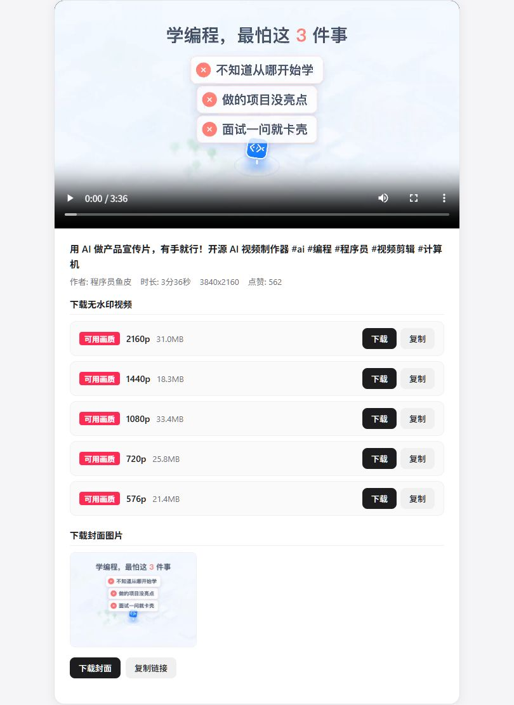
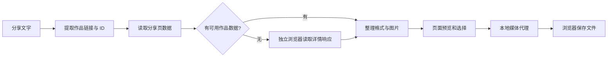

# DouyinLens · 抖音视频解析与下载

[简体中文](README.md) | [English](README.en.md)

把一段抖音分享文案变成可预览、可选择清晰度的视频下载结果，也支持图集和封面。适合在本机保存自己有权使用的作品，并沿源码理解分享页数据、浏览器响应和媒体流之间的关系。

Python 提供本地页面与媒体代理，Playwright 在分享页缺少数据时加载作品页。无需模型 Key、数据库或收费解析接口。程序默认只监听本机。

[启动](#在本机启动) · [解析并下载](#从分享文案到本地文件) · [实现原理](#为什么需要两条解析路径) · [排查](#解析失败时看哪里)

## 在本机启动

准备 Python 3.10+ 和能访问抖音及其 CDN 的网络。在 Windows PowerShell 运行：

```powershell
git clone https://github.com/kayaduster607-jpg/douyin-lens.git
cd douyin-lens
python -m venv .venv
.\.venv\Scripts\python.exe -m pip install -r requirements.txt
.\.venv\Scripts\python.exe app.py
```

打开 [http://127.0.0.1:8080](http://127.0.0.1:8080)。程序依次尝试系统 Edge、Chrome、Playwright Chromium；如果电脑没有可用浏览器，在同一虚拟环境中安装：

```powershell
.\.venv\Scripts\python.exe -m playwright install chromium
```

## 从分享文案到本地文件

1. 在抖音复制一条可正常打开的作品分享文案，整段粘贴到输入框。只提供作品链接也可以，程序会提取 URL、跟随短链并识别作品 ID。
2. 点击“解析视频”，等待标题、封面和播放区域出现。需要浏览器兜底时，新作品可能等待数十秒。
3. 视频选择**实际列出的**清晰度后下载；图集从图片列表逐张下载；封面使用单独的封面按钮。
4. 在浏览器下载管理器查看进度，完成后打开文件。仅出现封面或预览不代表完整视频已保存。

| 输入 | 页面输出 | 文件输出 |
| --- | --- | --- |
| 视频分享文字 / 链接 | 标题、封面、视频预览、可用格式 | MP4，进入浏览器下载目录 |
| 图集分享文字 / 链接 | 图片列表与预览 | 选中的图片文件 |
| 已解析作品的封面操作 | 封面 | 单独图片文件 |

下载不会默认把视频放进仓库。分辨率和码率来自上游详情响应，不保证每个作品都提供 1080p 或 4K；程序也不做超分辨率处理。

### 页面示例



图片是历史真实运行截图，显示作品信息、视频预览和可下载格式；其第三方作品版权归原作者。可展开查看 [首页截图](docs/assets/runtime-home.jpg)，运行条件和记录见 [docs/verification.md](docs/verification.md)。页面保留 `DouYinDownloader` 字样，仓库名称为 DouyinLens。

## 为什么需要两条解析路径



分享页内嵌作品数据时，直接请求即可解析；页面缺字段时，单加 User-Agent 不会运行 JavaScript，程序转而用独立浏览器监听目标作品的详情响应。拿到详情后，从同一份数据整理视频地址、`bit_rate`、封面和图集，按分辨率去重并保留较高码率。

下载阶段再由 Python 设置媒体请求头、代理上游流，并转发 Range、Content-Range 和 HTTP 206。**找出播放地址和传输视频内容是两个步骤**，因此解析成功后仍可能在 CDN 下载阶段失败。

浏览器使用独立会话，不读取已有个人浏览器资料。成功的浏览器结果在内存缓存 180 秒、最多 32 条；未命中的浏览器解析串行执行，HTTP 服务本身使用多线程。缓存只覆盖浏览器结果，短链和分享页仍可能重新请求，不能将它理解为整条链路秒响应。

“无水印”指尝试取得平台已有的播放资源，包括将旧式 playwm 路径改为 play；不会擦除创作者已经嵌入画面的 Logo、字幕或水印。

## 解析失败时看哪里

| 现象 | 原因与下一步 |
| --- | --- |
| 分享页 HTTP 200，但没有视频 | 检查作品字段是否存在；程序会尝试浏览器详情路径 |
| 浏览器能播，程序失败 | 独立浏览器没有你的登录状态，作品权限、验证要求和网络条件可能不同 |
| 页面一直等待 | 新浏览器启动和详情等待需要时间；浏览器阶段预算为 45 秒，整条请求还包含其他网络步骤 |
| 缺少 Playwright / 浏览器 | 安装与启动是否使用同一虚拟环境；必要时安装 Chromium |
| 可预览但无法下载 | 查看媒体请求和 CDN 状态，不能只依据解析阶段判断 |

平台页面与访问条件会变化，私密、删除或受验证限制的作品不保证可用。当前版本没有公网鉴权、限流、配额或完整 SSRF 防护，部署时保留本机使用方式。

## 阅读源码与验证

- [原理详解.md](原理详解.md)：按请求顺序分析重定向、作品 JSON、请求头与 Range。
- [docs/api.md](docs/api.md)：本地接口的完整输入、输出和错误字段。
- `app.py`：分享页提取、Web 服务和媒体代理；`browser_parser.py`：浏览器、目标响应过滤与缓存。
- `templates/index.html`：输入、预览和下载界面。

```powershell
.\.venv\Scripts\python.exe -m unittest discover -s tests -v
```

单元测试使用模拟数据覆盖解析与代理逻辑，真实作品访问记录单独保存在验证文档。欢迎按 [CONTRIBUTING.md](CONTRIBUTING.md) 提交可复现问题，分享时删除 Cookie、签名媒体地址和账号会话。

## 许可

代码与文档采用 [PolyForm Noncommercial 1.0.0](LICENSE)，保留 [NOTICE](NOTICE)，仅限许可允许的非商业用途。软件许可不授予第三方视频、图片、音乐的权利；项目与抖音、字节跳动无隶属关系。
