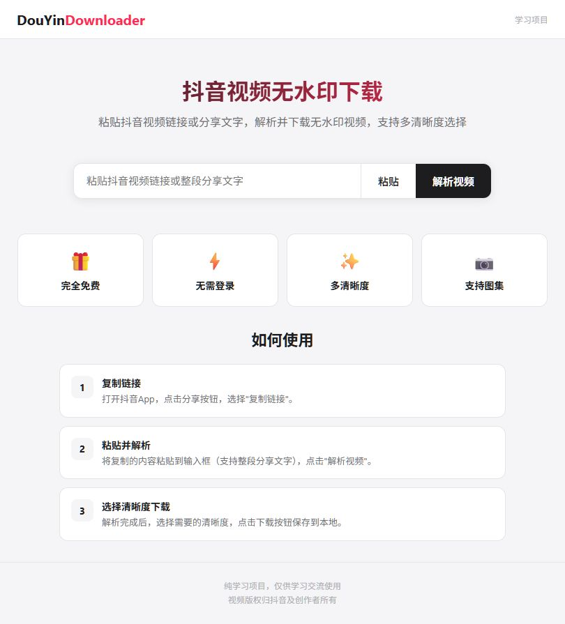
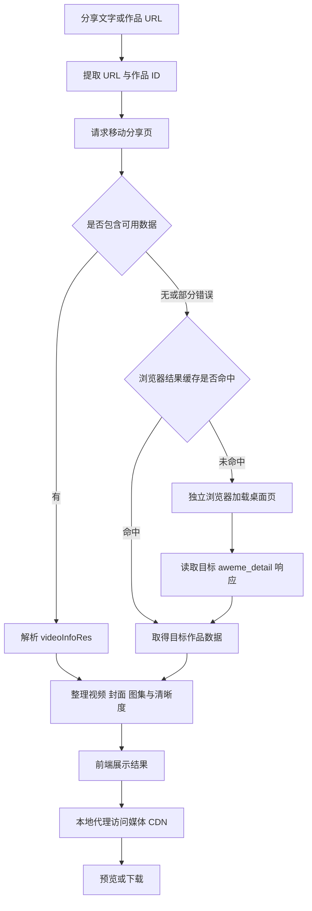

<div align="center">


# DouyinLens · 抖音无水印视频解析与下载

**从一条分享链接，读懂 HTTP、网页数据与视频流。**

<p>
  
  
  
  
</p>

[快速开始](#quick-start) · [真实运行](#demo) · [实现原理](#how-it-works) · [常见问题](#faq) · [参与学习](#contributing)

</div>

DouyinLens 是一个本地运行的 **Douyin video downloader / 抖音视频下载器** 学习项目。粘贴分享文字或作品链接，即可尝试解析公开作品，预览视频，选择接口实际提供的清晰度，下载视频、封面或图集。

项目用 Python 标准库提供 Web 服务，使用 **分享页数据提取 + Playwright 浏览器兜底** 获取作品信息。源码规模小，数据链路完整，适合练习 HTTP 重定向、SSR 数据提取、浏览器自动化、JSON 解析、媒体代理与 Range 分段传输。

**仅供非商业学习交流。** 项目采用 [PolyForm Noncommercial 1.0.0](LICENSE) 公开源码；禁止商业使用，不属于允许商用的 OSI 开源许可。软件许可不授予任何第三方视频、音乐或图片的使用权。

如果这个项目让你看懂了“浏览器能播，Python 为什么拿不到”的原因，欢迎点一个 **Star**，也欢迎带着实验记录来讨论。

<a id="demo"></a>

## 先用一次：分享文字输入后，下载什么文件

| 你输入什么 | 解析后得到什么 | 点下载后得到什么 |
| --- | --- | --- |
| 抖音视频链接，或包含链接的整段分享文案 | 标题、封面、实际可获取的清晰度 | 浏览器下载的MP4 |
| 可访问的图集分享内容 | 图片列表与预览 | 单张图片文件 |
| 已解析作品 | 封面操作 | 单独的封面图片 |

### 第一次操作

1. 按后文“三步在本机运行”安装Python依赖及所需浏览器，启动 `app.py`，打开 `http://127.0.0.1:8080`。不需要模型Key、账号系统或收费解析接口。
2. 在抖音中复制一条自己有权保存、能正常打开的作品分享文案。**整段粘贴即可**，输入框会提取其中的链接；不要把下载器页面自己的地址粘进去。
3. 点击“解析视频”，等待作品信息出现。视频看清晰度列表，图集看图片列表，封面使用对应下载按钮。
4. 选一个实际列出的格式，点击“下载”。在浏览器下载管理器确认完成，并打开文件检查。

**输出在哪里：**文件由浏览器下载到你设置的目录；仓库目录不是默认视频存放目录。界面列出的是解析响应实际提供的格式，不承诺每个作品都有1080p、4K或同样的清晰度。

**什么算失败：**作品已删除、私密、风控或网络不可达时可能解析失败。输入有效链接与取得下载权限不是一回事；不能把“正在解析”或“已显示封面”当作完整视频已保存。

## 看看它如何工作

以下图片来自直接启动本项目后的真实页面，未替换界面或伪造数据。页面保留原有 `DouYinDownloader` 字样，仓库展示名称为 DouyinLens。

<p align="center">
  
</p>

<details>
<summary>展开查看真实首页</summary>

<p align="center">
  
</p>

</details>

当前演示使用分享链接：[用 AI 做产品宣传片，有手就行！开源 AI 视频制作器](https://v.douyin.com/M8wgmAEea1k/)。截图中的第三方作品仅用于说明界面，版权归原作者所有，不随本项目许可再授权。运行环境与验证边界见 [实测记录](docs/verification.md)。顶部封面为生成的项目视觉图，以上两张为真实截图。

## 你可以用它做什么

| 功能 | 实际行为 |
| --- | --- |
| 分享文字解析 | 从整段文案中提取有效抖音 URL，跟随短链接跳转 |
| 多种作品链接 | 识别 `/video/`、`/note/` 等路径及 `modal_id`、`aweme_id`、`item_id` 参数 |
| 两条数据路径 | 优先读取分享页内嵌数据；缺少数据时加载桌面作品页 |
| 视频预览与下载 | 通过本地媒体代理预览和下载接口返回的地址 |
| 实际可用清晰度 | 根据 `play_addr`、`bit_rate` 整理分辨率；同一分辨率保留较高码率 |
| 封面和图集 | 整理上游提供的封面及图片列表，提供逐张下载入口 |
| 分段传输 | 转发 `Range`、`Content-Range` 与 HTTP 206，支持视频按需读取 |
| 本地临时会话 | 浏览器不读取现有个人资料；成功的浏览器结果短暂缓存在内存中 |

“无水印”指尝试取得平台提供的相应播放资源。代码对旧式 `/playwm/` 路径替换为 `/play/`，**不执行图像修复，不会去掉创作者已嵌入画面的字幕、Logo 或水印**。不同作品以返回资源为准。

<a id="quick-start"></a>
## 三步在本机运行

已验证环境为 Windows、Python 3.13.5、Microsoft Edge。源码要求 Python 3.10+。其他平台尚未完成实机验证。

### 1. 获取项目

```powershell
git clone https://github.com/kayaduster607-jpg/douyin-lens.git
cd douyin-lens
```

也可点击 GitHub 的 **Code → Download ZIP**，解压后进入项目目录。

### 2. 安装依赖

建议创建独立虚拟环境。PowerShell 无需激活环境也可运行：

```powershell
python -m venv .venv
.\.venv\Scripts\python.exe -m pip install -r requirements.txt
```

程序依次尝试系统 Edge、系统 Chrome、Playwright Chromium。没有可用 Edge/Chrome 时，安装 Chromium：

```powershell
.\.venv\Scripts\python.exe -m playwright install chromium
```

### 3. 启动并打开页面

```powershell
.\.venv\Scripts\python.exe .\app.py
```

访问 **[http://127.0.0.1:8080](http://127.0.0.1:8080)**，粘贴分享内容，点击“解析视频”，等待结果后选择下载。

当前版本不需要配置文件、API Key、数据库或收费解析服务。需要电脑能够正常访问抖音及其媒体 CDN。访问结果受网络和平台条件影响。

## 为什么保留两条解析路径

| 遇到的问题 | 本项目的处理 |
| --- | --- |
| 分享页内嵌了作品 JSON | 直接提取数据，无需启动浏览器 |
| 页面可访问，但作品 JSON 缺失 | 独立浏览器加载桌面页，读取目标作品详情响应 |
| HTTP 200 却没有视频 | 区分传输成功与业务成功；字段缺失不再伪装成状态码 `-1` |
| 修改参数就声称支持 4K | 仅列出接口实际返回的地址与分辨率 |
| 视频流占住唯一 HTTP 线程 | 使用多线程 HTTP 服务；浏览器任务仍串行运行 |

两条解析路径都用于**取得已有的播放地址**；真正下载时仍由 Python 带适当请求头访问媒体服务器。

<a id="how-it-works"></a>
## 实现原理



可以沿着数据链路学习四个问题：

1. **链接里没有 MP4，地址从哪里来？** 从作品页面数据或浏览器正常发出的详情请求中读取；作品 ID 不能直接算出可用 CDN 地址。
2. **`User-Agent` 为什么不够？** 它是请求头，不会运行 JavaScript，也不能补出响应里没有的数据。带请求头访问文件与找到文件地址是不同环节。
3. **为什么需要本地代理？** Python 统一设置媒体请求头，向前端转发内容和分段响应。不同 CDN 的实际条件可能变化。
4. **为什么多个清晰度只解析一次？** 一个详情响应可包含多个 `bit_rate` 条目，程序从同一份 JSON 整理地址，没有逐档启动浏览器。

📖 **[完整原理详解](原理详解.md)**：逐步数据流、源码入口、字段示例、旧方法失效排查、请求头与 Range 代理。

📘 **[本地接口与字段说明](docs/api.md)**：三个 API 的输入输出和错误处理。

## 性能与缓存：如实说明

2026-10-19 的早期兼容性验证中，另一条公开视频的完整 Python 解析耗时 **37.8 秒**，随后网页测试的解析请求约 **33 秒**。这组历史记录不对应当前 AI 产品宣传片截图，也不是平均值、服务承诺或所有视频的耗时。

当前实现优先恢复兼容性：每个未命中缓存的浏览器任务启动独立浏览器，加载页面，等待详情数据，再关闭浏览器。资源加载、全新会话和页面等待都会增加成本。

| 机制 | 当前参数及含义 |
| --- | --- |
| 浏览器阶段等待 | 45 秒；是等待预算，不是固定睡眠，也不是整条请求的总超时 |
| 普通页面请求 | 单次 20 秒；短链接和分享页可能依次发生 |
| 成功浏览器结果缓存 | 180 秒、最多 32 条、仅进程内保存 |
| 缓存位置 | 只覆盖浏览器结果；命中前仍会请求分享页和必要的短链跳转 |
| 并发方式 | HTTP 多线程；浏览器解析由全局锁串行执行 |

当前没有实现“所有视频秒解析”。分阶段计时、浏览器复用、提前结束页面等待、资源筛选和完整链路缓存属于后续研究方向。

<a id="faq"></a>
## 常见问题

<details>
<summary><b>分享页没有视频数据，是否意味着视频已删除？</b></summary>

不能这样推断。HTML 返回成功与作品数据存在是两件事。本次兼容修复中，同一作品的移动分享页没有 `videoInfoRes`，独立 Edge 加载桌面页却正常获得了详情。应以响应证据判断。

</details>

<details>
<summary><b>网页版可以播放，为什么程序仍可能失败？</b></summary>

独立浏览器没有你已登录的个人会话。登录或验证要求、地区和网络、作品权限及页面变化都可能导致差异。程序不自动处理验证码，不读取现有浏览器登录资料，也不保证每个作品可解析。

</details>

<details>
<summary><b>是否一定有 1080p 或 4K？</b></summary>

以接口实际返回的数据为准。程序按画面短边标注分辨率，不做超分辨率处理，也不通过拼接 `ratio=4k` 宣称获得了 4K。码率、编码与文件大小也会影响画质。

</details>

<details>
<summary><b>为什么每个新视频都可能等数十秒？</b></summary>

新视频未命中缓存时会重新启动浏览器。3 分钟缓存仅针对浏览器结果，不是完整请求链路的缓存。详见“性能与缓存”及原理文档。

</details>

<details>
<summary><b>能直接部署成公开下载网站吗？</b></summary>

当前定位是本机学习工具，默认只监听 `127.0.0.1`。没有公网鉴权、速率限制、任务配额或完整跨站访问防护，不能把域名白名单当成完整 SSRF 防护。请保留本地使用方式，不将本版本直接作为公网服务。

</details>

<details>
<summary><b>安装成功后仍提示缺少 Playwright？</b></summary>

安装依赖和启动程序应使用同一个 Python。推荐直接使用快速开始中的 `.venv\Scripts\python.exe`，避免多个 Python 环境混用。

</details>

## 源码地图

```text
douyin-lens/
├── app.py                 # Web 服务、分享页解析、结果整理、媒体代理
├── browser_parser.py      # 浏览器、响应监听、超时与短期缓存
├── templates/index.html   # 输入、预览与下载界面
├── requirements.txt       # 固定版本的 Playwright 依赖
├── tests/test_parser.py   # 10 项解析与代理回归测试
├── 原理详解.md             # 从链接到视频流的完整学习材料
├── docs/
│   ├── api.md             # 本地 API
│   ├── verification.md    # 验证记录与边界
│   └── assets/            # 生成封面与真实截图
├── CONTRIBUTING.md        # 学习交流与提交规范
├── NOTICE                 # 署名、第三方内容说明
└── LICENSE                # PolyForm Noncommercial 1.0.0
```

## 本地检查

```powershell
.\.venv\Scripts\python.exe -m unittest discover -s tests -v
```

10 项回归测试覆盖链接提取、域名验证、SSR 字段缺失、浏览器兜底、实际清晰度、目标响应过滤，以及错误 HTTP 状态和 Range/206 转发。测试使用模拟数据验证确定性逻辑；真实作品访问另行验证，二者不混为一谈。

<a id="contributing"></a>
## 一起把原理弄清楚

欢迎用 Issue 分享页面变化、可复现错误和性能观测，通过 Pull Request 改善文档、测试和实现。提交前阅读 [CONTRIBUTING.md](CONTRIBUTING.md)，不要上传 Cookie、账号会话、完整签名媒体地址或他人的视频文件。

适合继续探索的方向：

- [ ] 给重定向、分享页和浏览器阶段增加独立计时。
- [ ] 比较浏览器复用与临时会话的速度、资源和可靠性。
- [ ] 验证拿到详情响应后更早结束页面加载是否稳定。
- [ ] 增加图集实测、异常场景与跨平台验证。
- [ ] 完善请求边界与资源控制，再讨论更多部署场景。

**学习有收获，欢迎 Star；遇到新问题，欢迎带着证据一起研究。**

## 许可与作品权利

代码和文档采用 [PolyForm Noncommercial 1.0.0](LICENSE)。非商业学习、研究、实验与交流请遵守原文并保留 [NOTICE](NOTICE)；本项目不提供商业使用授权。参考：[SPDX 标准文本](https://spdx.org/licenses/PolyForm-Noncommercial-1.0.0.html)。

本项目与抖音、字节跳动无隶属或合作关系。只处理你有权访问、下载与使用的内容，遵守适用的平台规则及创作者授权。第三方媒体、商标和截图中的作品不属于本项目授权范围。
