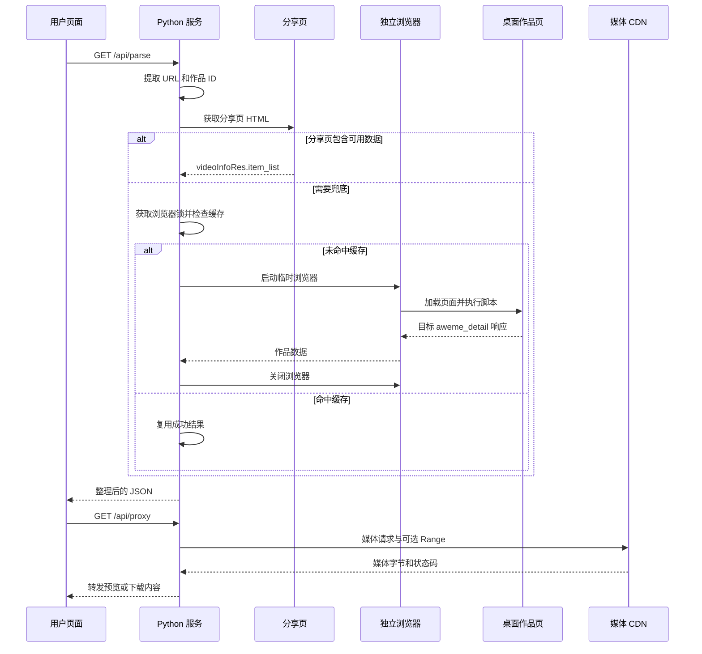

# DouyinLens 原理详解：从分享链接到视频流

> 对应当前仓库代码，介绍实际实现、2026-10-19 排查证据与尚未验证的部分。字段示例仅解释结构，不包含真实 Cookie、登录资料或可用的媒体签名。

## 1. 先分清四种地址

| 名称 | 结构示例 | 用途 |
| --- | --- | --- |
| 分享短链接 | `https://v.douyin.com/<share-code>/` | 重定向定位作品 |
| 作品页面 | `https://www.douyin.com/video/<aweme_id>` | 浏览器展示作品 |
| 详情接口 | `/aweme/v1/web/aweme/detail/?aweme_id=...` | 返回元数据与媒体地址 |
| 媒体地址 | 响应中的 CDN URL 或旧式播放 URL | 返回实际视频字节 |

作品页通常返回 HTML，媒体地址才返回视频内容。作品编号 `aweme_id` 不等于旧播放接口的视频资源 `uri`，也不等于带签名和有效期的 CDN URL。

因此，“得到作品 ID”和“得到可下载地址”是两个阶段，不能只凭作品 ID 计算一个永久有效的 MP4 链接。

## 2. 源码阅读地图

| 文件 | 职责 | 入口 |
| --- | --- | --- |
| `templates/index.html` | 输入、请求、展示、下载 | `doParse()`、`showResult()`、`proxy()` |
| `app.py` | Web 服务、分享页、字段整理、媒体代理 | `handle_parse()`、`parse_video_item()`、`open_media()` |
| `browser_parser.py` | 独立浏览器、目标响应、缓存 | `get_video_item()`、`load_video_item()` |
| `tests/test_parser.py` | 核心逻辑回归 | `ParserTests`、`HTTPTests` |



## 3. 从分享文字提取 URL

`extract_url_from_text()` 先寻找 HTTP/HTTPS URL 候选，再按解析后的主机名验证是否为 `douyin.com`、`iesdouyin.com` 或它们的子域名。会去掉候选地址末尾的常见中文标点。

以下地址虽然含抖音域名字符串，目标主机却不是抖音：

```text
https://douyin.com.example.org/video/123
https://example.org/?source=douyin.com
```

这解释了为什么主机名匹配优于简单的子串匹配，也解释了为什么这个检查不能替代所有其他请求安全控制。

## 4. 跟随短链接并识别作品 ID

`resolve_short_url()` 通过 `urllib` 跟随 HTTP 重定向，读取最终响应后返回最终 URL。当前实现并非只处理一次 `Location` 头，也会读取最终页面内容。

`extract_video_id()` 支持：

- `/video/<id>`、`/note/<id>`、`/modal/<id>` 路径。
- `modal_id`、`aweme_id`、`item_id` 查询参数。

网页版“我的喜欢”可能使用 `/user/self?modal_id=...`，作品编号放在参数里。程序不再从整个 URL 中随便找一段长数字，避免将用户编号当作作品编号。

## 5. 优先读取分享页内嵌数据

`get_video_info_from_share_page()` 请求：

```text
https://www.iesdouyin.com/share/video/<aweme_id>/
```

旧实现依赖 HTML 中的 `window._ROUTER_DATA`。以下为简化的示意结构，英文大写值是字段解释，不是运行配置：

```json
{
  "loaderData": {
    "video_(id)/page": {
      "videoInfoRes": {
        "status_code": 0,
        "item_list": [{
          "aweme_id": "VIDEO_ID",
          "desc": "作品描述",
          "video": {
            "play_addr": {
              "url_list": ["PLATFORM_PROVIDED_URL"]
            }
          }
        }]
      }
    }
  }
}
```

程序用正则定位路由 JSON，使用 `json.loads()` 解析，寻找含 `videoInfoRes` 的页面条目。成功时直接整理结果，不启动浏览器。

前提是**本次响应确实包含作品数据**。某次成功不能证明该页面永远内嵌数据。

## 6. 为什么旧方法这次失效

旧代码曾使用：

```python
status_code = video_info_res.get("status_code", -1)
```

页面缺少 `videoInfoRes` 时，程序先取到空字典，再把缺失状态填为 `-1`。所以原来的“API 返回错误，状态码 -1”来自本地默认值，不能证明平台真的返回了 -1。

### 已确认事实

2026-10-19 对同一公开作品的排查显示：

1. 短链接能够跳转，作品编号能够提取。
2. 移动分享页返回 HTML，并包含 `_ROUTER_DATA`。
3. 本次路由数据没有 `videoInfoRes`，旧解析前提不成立。
4. 当时直接请求旧详情接口得到空响应；一次直接桌面详情请求返回 HTTP 403。
5. 独立、未登录的桌面 Edge 正常加载作品页后，详情接口返回含 `aweme_detail` 的 JSON。
6. 取得地址后，Python 请求返回 `video/mp4`、HTTP 206 与 MP4 文件头；网页预览与完整下载已通过验证。

### 合理解释与未验证部分

页面策略、会话和访问条件可能参与造成响应差异。可以确认当前访问结果与旧解析器的要求不同；不能确认平台何时、为何统一修改了全部页面，也没有逐项证明哪个 Cookie、签名或请求头决定成败。

项目没有逆向或复刻平台签名算法。一次 403 不足以证明“所有直接接口永久失效”，分享页字段缺失也不足以证明作品已删除。

### 当前处理

缺少 `videoInfoRes` 时转入浏览器路径，不伪造状态码。上游明确返回 `SYSTEM_ITEM_NOT_EXIST` 时才使用对应的不可用提示。其他部分错误仍可触发浏览器兜底。

本地 `/api/parse` 成功返回 200，`handle_parse()` 返回错误时通常使用 502；具体前置检查和异常状态见 [API 文档](docs/api.md)。

## 7. 浏览器兜底究竟做了什么

`get_video_item()` 先取得全局浏览器锁，再查短期缓存。未命中时使用 Playwright，依次尝试系统 Edge、Chrome、Playwright Chromium，启动新的无界面浏览器。

它不打开用户现有个人资料，不导入已登录会话。浏览器正常加载桌面作品页并执行网页脚本，建立临时页面环境。

`load_video_item()` 监听响应，`read_detail_response()` 只接收满足下列条件的作品数据：

| 项目 | 条件 |
| --- | --- |
| 主机 | `www.douyin.com` |
| 路径 | `/aweme/v1/web/aweme/detail/` |
| 请求作品 ID | `aweme_id` 等于用户目标 ID |
| 状态 | HTTP 200 |
| 响应作品 ID | `aweme_detail.aweme_id` 再次等于目标 ID |

网页可能加载推荐作品，因此既检查请求 ID，也检查响应 ID，避免拿错视频。

退出时通过 `finally` 关闭浏览器。程序不自动登录、解验证码或绕过权限；目标页面不提供可用数据时仍会失败。

## 8. 请求头为什么有时不够

| 请求头 | 当前用途 | 边界 |
| --- | --- | --- |
| `User-Agent` | 声明客户端类型 | 不执行 JS，不补出缺失数据，不保证永久通过检查 |
| `Referer` | 媒体请求设置抖音来源 | 不能保证平台一定允许请求 |
| `Accept-Encoding` | 页面接受 gzip/deflate，媒体使用 identity | 不改变作品访问权限 |
| `Range` | 请求字节区间 | 上游需要支持才会返回正确分段数据 |

“拼浏览器的开头”通常指设置 `User-Agent`。它只是请求头字符串，不等于真正执行网页脚本的浏览器。

本次主要断点是**获取作品数据与媒体地址**；拿到地址后，Python 带请求头访问媒体的方式仍实测有效。

## 9. 一次解析为何能返回多档清晰度

详情响应中的 `video.play_addr` 和 `video.bit_rate` 可包含多个地址。`get_available_qualities()`：

1. 只保留上游实际提供且通过域名检查的 URL。
2. 读取地址对象里的宽高，按短边生成 `720p` 等标签；缺失时显示“默认”。
3. 同一分辨率保留较高 `bit_rate`，按分辨率降序排列。
4. 有 `data_size` 时直接显示大小，否则前端可请求 `/api/filesize`。

竖屏 `2160 × 3840` 会标为 `2160p`。这只反映画面像素尺寸，不证明原生拍摄画质，也没有进行超分辨率处理。编码和码率同样影响观感与文件大小。

多个选项来自同一份 JSON，没有逐档重新启动浏览器，没有在显示结果前下载所有画质。正常加载的浏览器页面本身可能会请求播放片段，这是额外流量来源。

旧版拼接 `ratio=540p/720p/1080p/4k` 不能证明对应画质真的存在，因此当前版本改为展示实际条目。

## 10. 无水印的准确含义

`playback_url()` 从 `url_list` 选择地址。遇到旧式 `/playwm/` 路径时替换为 `/play/`；CDN 地址则直接使用。

这是请求已有播放资源，没有修改视频像素。不能去除创作者已嵌入画面的字幕、Logo、水印，也不能承诺每个作品都返回相同特征的资源。

软件免费、公开源码和非商业用途，都不会自动产生第三方作品的下载、传播或再利用授权。

## 11. 本地代理如何传输视频

前端把媒体地址编码后交给：

```text
GET /api/proxy?url=<编码后的媒体地址>
```

`open_media()` 设置媒体请求头并请求上游；处理器每次最多读取 65536 字节并流式转发。程序不进行转码，也不主动在项目目录保存视频；浏览器下载时才由用户选择保存位置。

直接跨站加载失败可能涉及来源检查、签名有效期、请求头、会话或其他策略，不能把每个 403 都归因于某一个固定请求头。

### 域名验证

`is_allowed_url()` 按协议、真实主机名、端口和 URL 认证信息校验；`MediaRedirectHandler` 对媒体重定向目标再次验证，避免只判断 `"douyin" in url`。

这些检查不是完整的公开服务安全边界：普通页面请求使用不同的重定向处理；没有完整 DNS/IP 校验、浏览器子资源限制、鉴权、配额或跨站请求防护。当前版本应维持本地运行。

### Range 与 HTTP 206

浏览器可请求：

```http
Range: bytes=0-1023
```

上游支持时可能返回以下结构，数字仅作说明：

```http
HTTP/1.1 206 Partial Content
Content-Type: video/mp4
Content-Range: bytes 0-1023/3965356
Content-Length: 1024
```

代理转发状态和对应头部，让浏览器知道这是文件的一部分。上游返回 200 时不会伪造 206。这是预览按需读取和拖动进度的重要基础。

`ThreadingHTTPServer` 让解析、封面和视频流可并发处理，避免视频占住全部服务。但浏览器任务仍由锁串行执行，不等于无限并行解析。

## 12. 当前速度与缓存的真实行为

请求耗时可概念性拆为：

```text
必要的短链请求 + 分享页请求 + 等待浏览器锁
+ 启动浏览器 + 页面与详情请求 + 关闭浏览器和整理结果
```

普通页面单次超时 20 秒；浏览器页面导航与结果等待使用 45 秒预算。启动、响应读取和关闭等还有额外开销，因此 45 秒不是完整请求总超时，也不是固定睡眠。

导航使用 `wait_until="domcontentloaded"`。即使较早收到详情响应，外层也需等 `page.goto()` 返回才能继续检查结果。这是潜在优化点，尚未单独测量其占比。

### 缓存规则

- 只缓存成功的浏览器作品数据。
- TTL 180 秒，最多 32 条，在 Python 内存中保存，重启清空。
- 获取浏览器锁后才检查缓存。
- 外层仍先请求分享页及必要的短链跳转。
- 失败结果不缓存，浏览器进程不跨视频复用。

因此每个新作品、同一作品缓存过期后都可能重新启动浏览器；命中缓存也不等于整条请求不再联网。

### 实测与目标分开

2026-10-19 的一次完整 Python 解析为 37.8 秒，随后网页测试解析请求约 33 秒。没有逐阶段计时，也没有足够样本得出平均值或分位数。

阶段计时、完整链路缓存、浏览器复用、资源筛选和更早结束导航属于后续研究。讨论中的“数秒级”是优化目标，当前没有实现或验证该速度承诺。

## 13. 如何读懂错误与证据

| 现象 | 可以判断 | 不能直接判断 |
| --- | --- | --- |
| HTML 返回 200 | 页面响应传输成功 | 一定有视频数据 |
| `_ROUTER_DATA` 存在 | 有路由初始化数据 | 一定包含 `videoInfoRes` |
| 缺少 `videoInfoRes` | 本次 SSR 路径无可用数据 | 视频已删除或私密 |
| 一次请求返回 403 | 此次请求被拒绝 | 所有接口永久失效 |
| MP4 文件头与媒体响应 | 返回了视频字节 | 所有画质有效、画面一定无水印 |
| 单作品端到端成功 | 该环境与该作品的链路有效 | 所有视频和环境均有效 |

公开反馈请保留步骤、环境、错误正文和脱敏路径，不要分享完整签名 URL、Cookie、登录会话或第三方媒体文件。默认服务日志可能包含查询参数，发布前需要脱敏。

## 14. 推荐的学习实验

1. 从 URL 提取和作品 ID 开始，区分作品链接与媒体链接。
2. 阅读分享页抓取，观察重定向、压缩编码、HTML 与 JSON。
3. 比较字段缺失和上游明确返回错误，避免误报。
4. 解释为什么浏览器响应必须校验请求、响应两处作品 ID。
5. 结合清晰度条目理解分辨率、码率和文件大小。
6. 使用 Range 请求理解媒体分段传输。
7. 先跑回归测试，再对有权使用的作品做真实验证。

性能实验应先加阶段计时，再一次改变一个条件。单次成功不能替代可复现验证，速度改进也不应省略作品匹配和资源回收。

## 15. 继续阅读

- 项目 [README](README.md)、[API](docs/api.md)、[实测记录](docs/verification.md)。
- 源码：[`app.py`](app.py)、[`browser_parser.py`](browser_parser.py)、[`tests/test_parser.py`](tests/test_parser.py)。
- Python：[urllib.request](https://docs.python.org/3/library/urllib.request.html)、[http.server](https://docs.python.org/3/library/http.server.html)。
- Playwright：[Network](https://playwright.dev/python/docs/network)、[Browser contexts](https://playwright.dev/python/docs/browser-contexts)。
- HTTP：[RFC 9110, Range](https://www.rfc-editor.org/rfc/rfc9110.html#name-range)。

代码与本文以 [非商业许可](LICENSE) 发布；第三方作品权利独立于软件许可。
